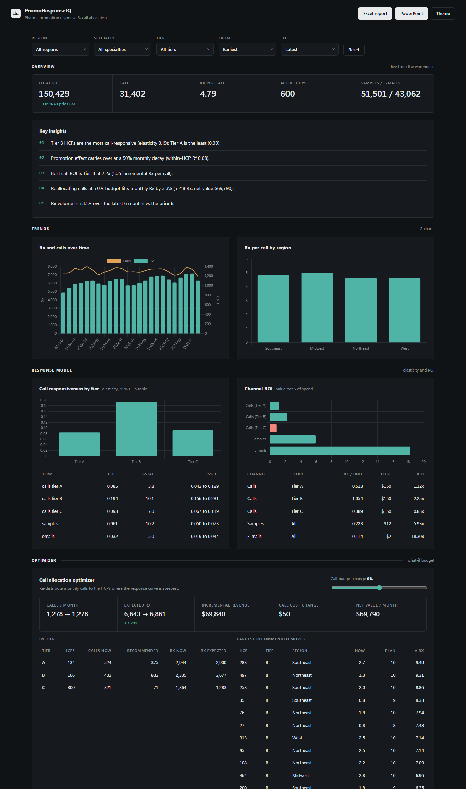

# PromoResponseIQ



**Which doctors should a pharma sales team call more, and which less?** PromoResponseIQ answers that with a SQL warehouse, a promotion-response model and a call-allocation optimizer, served through a live dashboard with one-click Excel and PowerPoint exports.

## The business problem
A pharma brand spends a fixed monthly budget on rep calls, samples and e-mails. Returns diminish, and responsiveness differs by HCP segment. The goal: measure each channel's true incremental Rx, then reallocate calls to lift prescriptions at the same budget.

## What it does
| Layer | Implementation |
|---|---|
| Warehouse | SQLite schema with constraints, indexes and BI-ready views (`v_hcp_month`, `v_monthly_summary`, `v_region_summary`) - connectable from Tableau / Power BI |
| Analytics | Parameterised SQL + pandas: KPIs, trend, region / specialty / tier breakdowns, top prescribers |
| Response model | HCP fixed-effects log-log regression with adstock carry-over (decay chosen by grid search), per-tier call elasticities, 95% CIs |
| Channel ROI | Incremental Rx and ROI per call, sample and e-mail using configurable economics |
| Optimizer | Greedy marginal allocation of the call budget (exact for concave curves); budget slider from -30% to +30% |
| Reporting | Interactive dashboard, auto-written insights, Excel workbook (8 sheets), PowerPoint deck (5 slides) |

Data is synthetic with a known ground truth (set in `config.json`), so tests prove the model recovers the true elasticities. Nothing is hard-coded: data size, tiers, economics, decay grid and call caps all come from `config.json`.

## Reading the model
Rx is a count with heavy Poisson noise, so the within-HCP R² is low (about 0.08) even when the response is identified correctly. The meaningful checks are the coefficients, their confidence intervals and the tests, which show the model recovers the known elasticities (A 0.10, B 0.22, C 0.15) from noisy data. The optimizer assumes concave (diminishing-returns) curves and reports expected, not guaranteed, uplift.

## Use your own data
Put `hcp.csv`, `activity.csv` and `rx.csv` (columns in `app/importer.py`) in a folder and run `python run.py --import-dir <folder>`. Files are validated first; a bad file never overwrites the live warehouse.

## Run it
```powershell
python -m venv .venv
.\.venv\Scripts\python -m pip install -r requirements.txt
.\.venv\Scripts\python run.py            # http://127.0.0.1:8000
.\.venv\Scripts\python run.py --reset-data   # regenerate the warehouse
.\.venv\Scripts\python -m pytest -q      # 36 tests
```

## Docker
```powershell
docker build -t promo-response-iq .
docker run -p 8000:8000 promo-response-iq
```


## API
`/api/meta`, `/api/kpis`, `/api/trend`, `/api/breakdown/{region|specialty|tier}`, `/api/top-hcps`, `/api/model`, `/api/optimize?budget_change_pct=`, `/api/insights`, `/api/export/xlsx`, `/api/export/pptx`. Filters: `region`, `specialty`, `tier`, `start`, `end` (YYYY-MM). Interactive docs at `/docs`.

## Stack
Python, SQL (SQLite), pandas, NumPy, FastAPI, Chart.js, openpyxl, python-pptx, pytest.

## Layout
```
app/            config, datagen, db, sql/, analytics, modeling, service, exports, main, static/
tests/          data + SQL, model + optimizer, API + exports
config.json     all tunables
```
